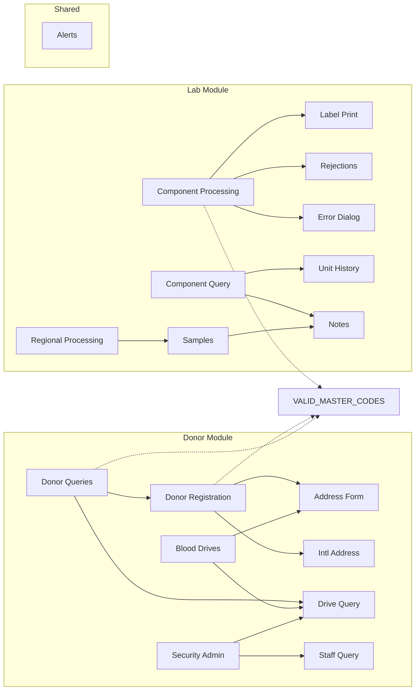

---
tags:
  - home
---

# Blood Center Screens Inventory

**Total Screens:** 906 | **Donor:** 370 | **Lab/Distribution:** 536

## Modules

- [[Donor]] (370 screens)
- [[Lab-Distribution]] (536 screens)

## Navigation Graphs

- **[[Screen Navigation Graph]]** — Mermaid diagrams showing all 204 screen-to-screen navigation links
- **Screen Navigation.canvas** — Visual canvas with 169 connected screens and 190 navigation arrows (open from file explorer)

## How to Use This Vault

1. **Graph View** (Cmd+G): See the full relationship network. Filter with `tag:#screen` to see ONLY screen-to-screen links
2. **Canvas**: Open `Screen Navigation.canvas` for the visual node graph with arrows
3. **Local Graph**: Click any screen note → open Local Graph to see its direct connections
4. **Tags**: Filter by `#screen`, `#table`, `#validation-table`, `#donor`, `#lab-distribution`
5. **Search**: Use Obsidian search to find screens by mnemonic, title, or table name

## Key Hub Screens

Most-connected screens in the system:

- [[mcqdrive]] — Drive Query (called by 26 screens)
- [[dpwaaddr]] — dpwaaddr (called by 24 screens)
- [[dpwiaddr]] — dpwiaddr (called by 16 screens)
- [[asglblpt]] — asglblpt (called by 16 screens)
- [[utqalert]] — utqalert (called by 8 screens)
- [[diahlp]] — Message (called by 8 screens)
- [[imquhist]] — Message (called by 7 screens)
- [[error]] — error (called by 6 screens)
- [[gewnotes]] — Error Window (called by 6 screens)
- [[warning]] — error (called by 6 screens)

## Most-Used Lookup Tables

These tables feed dropdown values across the system:

- [[VALID_MASTER_CODES]] (used by 156 screens)
- [[MASTER_CODES]] (used by 147 screens)
- [[UNITS]] (used by 61 screens)
- [[COMPONENTS]] (used by 58 screens)
- [[VALID_TESTS]] (used by 58 screens)
- [[EMPLOYEES]] (used by 49 screens)
- [[VSERV_MASTER]] (used by 48 screens)
- [[VALID_INTERDICTIONS]] (used by 45 screens)
- [[VALID_COLLECTION_AGENCIES]] (used by 44 screens)
- [[VALID_PRODUCTS]] (used by 42 screens)
- [[SYSTEM_USERS]] (used by 38 screens)
- [[DRIVES]] (used by 38 screens)
- [[SPONSORS]] (used by 36 screens)
- [[CONTRACTS]] (used by 36 screens)
- [[CUSTOMERS]] (used by 32 screens)

## Navigation Flow

