---
tags:
  - graph
  - navigation
---

# Screen Navigation Graph

**194 screens** connected by **204 navigation links** (CALL_FORM / OPEN_FORM / NEW_FORM)

This shows ONLY screen-to-screen navigation — which screens open which other screens.

> **Tip:** In Obsidian Graph View, use the filter `tag:#screen -tag:#table` to see only screen-to-screen connections.

## Complete Navigation Map

```mermaid
graph LR
    subgraph Donor_Module[Donor Module]
        agimangr["agimangr<br/>Serological & Molecular Manage"]
        caqoptim["caqoptim<br/>Drives over optimal cost"]
        dcimultd["dcimultd<br/>Donors by Events Query"]
        dcisingd["dcisingd<br/>Multiple Donor Query"]
        deidonbr["deidonbr<br/>List Browser"]
        dnwdebug["dnwdebug<br/>dnwdebug"]
        dnwdfind["dnwdfind<br/>Find Donor"]
        dpiaddnr["dpiaddnr<br/>Donor Profile- ADD DONOR"]
        dpiadtst["dpiadtst<br/>Add / Schedule Tests"]
        dpirmprp["dpirmprp<br/>Remove Donor Attributes"]
        dpqagdts["dpqagdts<br/>New Program"]
        dpqdrdtl["dpqdrdtl<br/>Donor Details Query"]
        dpucatst["dpucatst<br/>Cancel Test Results"]
        dpuinvst["dpuinvst<br/>Investigate "]
        dpukydat["dpukydat<br/>Donor Profile- Modify Key Data"]
        dpuvoidr["dpuvoidr<br/>Void Test Results"]
        dpwaaddr["dpwaaddr<br/>dpwaaddr"]
        dpwdemgr["dpwdemgr<br/>DONOR PROFILE DEMOGRAOHY"]
        dpwiaddr["dpwiaddr<br/>dpwiaddr"]
        dridfaud["dridfaud<br/>Deferral Audit"]
        drireaud["drireaud<br/>Nursing Audit"]
        driredef["driredef<br/>Deferral Registration"]
        driregis["driregis<br/>Donation Registration"]
        drqdfhld["drqdfhld<br/>drqdfhld"]
        drqnoaud["drqnoaud<br/>drqnoaud"]
        drqnodef["drqnodef<br/>drqnodef"]
        drqonhld["drqonhld<br/>Donations On Hold"]
        drudfaud["drudfaud<br/>Deferral Audit Maintenance"]
        drudrchk["drudrchk<br/>Sponsor Contacts"]
        drureaud["drureaud<br/>Donation Audit Maintenance"]
        druredef["druredef<br/>Update Deferral"]
        druregis["druregis<br/>Maintain Donation Registration"]
        drurehld["drurehld<br/>Attach Donor"]
        drurmdfr["drurmdfr<br/>Detach donor from deferral"]
        drurmdnr["drurmdnr<br/>Detach donor from unit"]
        drwdefrl["drwdefrl<br/>DRWDEFRL [3.01.02]            "]
        drwentry["drwentry<br/>DRWENTRY [3.01.03]            "]
        dsimangr["dsimangr<br/>Donor Survey Manger"]
        dsischdl["dsischdl<br/>Donor Scheduling / Appointment"]
        dsislink["dsislink<br/>New Program"]
        dsqfsdrv["dsqfsdrv<br/>Fixed Site Drives Data Query"]
        dsqsdets["dsqsdets<br/>Site Directions"]
        hrireqst["hrireqst<br/>HLA RBC REQUEST"]
        hrureqst["hrureqst<br/>hrureqst"]
        inherit["inherit<br/>User Verification"]
        ltilogon["ltilogon<br/>Chapters"]
        ltismenu["ltismenu<br/>Application Menu System"]
        ltqrview["ltqrview<br/>Report Preview"]
        mcidrloc["mcidrloc<br/>Define Donor Center"]
        mcimobdr["mcimobdr<br/>Create/Modify Mobile Drives"]
        mcinwmsg["mcinwmsg<br/>Message Communication"]
        mcqcalen["mcqcalen<br/>Master Calendar"]
        mcqdrive["mcqdrive<br/>Drive Query"]
        mcqdrlmp["mcqdrlmp<br/>Query Lists"]
        mcqmulti["mcqmulti<br/>mcqmulti"]
        mcqpiggy["mcqpiggy<br/>mcqpiggy"]
        mricampg["mricampg<br/>mricampg"]
        mridrsgn["mridrsgn<br/>Drive Sign Off"]
        mrispcnt["mrispcnt<br/>Sponsor Contacts"]
        mrispns2["mrispns2<br/>Maintain Sponsors"]
        mrqcampg["mrqcampg<br/>MRQCAMPG"]
        mrqdrbyr["mrqdrbyr<br/>Drives and Goals by Recruiter "]
        mrqrecdr["mrqrecdr<br/>Checklist Notes."]
        mrqsayer["mrqsayer<br/>Goals Vs Booked and Actuals Qu"]
        mrqspall["mrqspall<br/>mrqspall"]
        mrqspter["mrqspter<br/>mrqspter"]
        mrqtertr["mrqtertr<br/>mrqtertr"]
        mruhktml["mruhktml<br/>Update Drive Checklist"]
        onilkreg["onilkreg<br/>Onsite Lookup and Registration"]
        onisetup["onisetup<br/>Setup Drive ID and Date"]
        onqstats["onqstats<br/>Onsite status query"]
        ppipbags["ppipbags<br/>PPIPBAGS"]
        ppipdrvr["ppipdrvr<br/>PPIPDRVR"]
        ppipshed["ppipshed<br/>Pickup Schedule"]
        ppqpicks["ppqpicks<br/>Drives"]
        rmiureps["rmiureps<br/>Print Status"]
        sdipatsg["sdipatsg<br/>Special Patients"]
        sdiphysc["sdiphysc<br/>Physician List"]
        ssiasign["ssiasign<br/>Pre Assignment"]
        ssidrskl["ssidrskl<br/>Skill Rating and Remarks"]
        ssiecomm["ssiecomm<br/>View All Staff Schedule with C"]
        ssqcolln["ssqcolln<br/>ssqcolln"]
        ssqconvl["ssqconvl<br/>Constraint Violation Query"]
        ssqdtdrv["ssqdtdrv<br/>Weekly Schedules"]
        ssqoutim["ssqoutim<br/>Donor Schedule Query"]
        ssqschid["ssqschid<br/>ssqschid"]
        ssqschtl["ssqschtl<br/>SSQSCHTL"]
        ssqstaff["ssqstaff<br/>SSQSTAFF"]
        ssqstday["ssqstday<br/>ssqstday"]
        ssufinal["ssufinal<br/>ssufinal"]
        ssumansc["ssumansc<br/>Assign Staff Manually"]
        sswsstat["sswsstat<br/>sswsstat"]
        triassgn["triassgn<br/>triassgn"]
        utqalert["utqalert<br/>utqalert"]
        vdiemply["vdiemply<br/>Maintain Staff Details"]
    end

    subgraph Lab_Module[Lab / Distribution Module]
        apilconv["apilconv<br/>APILCONV"]
        apiltlog["apiltlog<br/>APILTLOG"]
        asglblpt["asglblpt<br/>asglblpt"]
        cfiresqc["cfiresqc<br/>Unit Attributes"]
        cfirextr["cfirextr<br/>Batch ID"]
        cfirrxtr["cfirrxtr<br/>Batch ID"]
        cfwnotan["cfwnotan<br/>Error Window"]
        cnfiparm["cnfiparm<br/>CNF Report Parameters"]
        cpiphe2["cpiphe2<br/>Manual Entry of Unit ID"]
        cpiprmgr["cpiprmgr<br/>Sterile Docking"]
        cpirej["cpirej<br/>cpirej"]
        cpisdal2["cpisdal2<br/>Manual Entry of Unit ID"]
        cpispli2["cpispli2<br/>Manual Entry of Unit ID"]
        cpisplit["cpisplit<br/>Manual Entry of Unit ID"]
        cpqautos["cpqautos<br/>mcqexcpu"]
        cpqunit4["cpqunit4<br/>Separation Times"]
        csiudbcr["csiudbcr<br/>."]
        diahlp["diahlp<br/>Message"]
        entnews["entnews<br/>."]
        entnews2["entnews2<br/>."]
        eqqdiseq["eqqdiseq<br/>EQIEQUIP"]
        eqqdismn["eqqdismn<br/>EQIMAINT"]
        eqqdisqc["eqqdisqc<br/>EQIQCSHT"]
        eqqeqsts["eqqeqsts<br/>EQQEQSTS"]
        eqqmaint["eqqmaint<br/>EQQEVENT"]
        eqqqcdet["eqqqcdet<br/>EQQEVENT"]
        eqqsrvce["eqqsrvce<br/>EQQSRVCE"]
        error["error<br/>error"]
        gennews["gennews<br/>GENNEWS"]
        geqsamp["geqsamp<br/>GEQSAMP"]
        gewnotes["gewnotes<br/>Error Window"]
        gnqprdst["gnqprdst<br/>Manual Entry of Unit ID"]
        iiapimgr["iiapimgr<br/>Units"]
        iiftstcf["iiftstcf<br/>Manual Entry of Unit ID"]
        imibatch["imibatch<br/>aiidmisc"]
        imichkin["imichkin<br/>Manual Entry of Unit ID"]
        imichkof["imichkof<br/>Manual Entry of Unit ID"]
        imiretn["imiretn<br/>."]
        imquhist["imquhist<br/>Message"]
        laicdisb["laicdisb<br/>Manual Entry of Unit ID"]
        lailabe2["lailabe2<br/>Manual Entry of Unit ID"]
        laippprd["laippprd<br/>laippprd"]
        lairpint["lairpint<br/>teimscan"]
        laisuper["laisuper<br/>Enter Any Comment"]
        ltiasnrg["ltiasnrg<br/>Units in Batch"]
        lticntst["lticntst<br/>VCONTRCT"]
        ltilablog["ltilablog<br/>Application Users"]
        ltiresu1["ltiresu1<br/>Select Tests"]
        ltiwksht["ltiwksht<br/>Select Tests"]
        ltlreag["ltlreag<br/>List of Valid Test Kits"]
        menuitem["menuitem<br/>Group"]
        nyrsmsub["nyrsmsub<br/>RSM Report Parameters"]
        oeqchrg["oeqchrg<br/>Shipped Products"]
        oeqoflow["oeqoflow<br/>Manual Entry of Unit ID"]
        oeqpchrg["oeqpchrg<br/>List of patients"]
        oeqstat["oeqstat<br/>."]
        oeqtrack["oeqtrack<br/>Manual Entry of Unit ID"]
        opiallox["opiallox<br/>."]
        pkrepcl["pkrepcl<br/>Manual Entry of Unit ID"]
        rgcnfskp["rgcnfskp<br/>Manual Entry of Unit Id"]
        rgicntct["rgicntct<br/>Customer Override Confirmatory"]
        rgiresqc["rgiresqc<br/>Unit Attributes"]
        rgirextr["rgirextr<br/>Batch ID"]
        rgirsskp["rgirsskp<br/>Manual Entry of Unit Id"]
        rgismtin["rgismtin<br/>Multi Select List of Canned Co"]
        rgitubes["rgitubes<br/>Manual entry of unit ID"]
        rgqbtint["rgqbtint<br/>Result Parameter   Typ  Oth"]
        rgqexres["rgqexres<br/>Select Chapters"]
        rgqtubes["rgqtubes<br/>Manual entry of unit ID"]
        rmqrgqry["rmqrgqry<br/>RMRGRCPT"]
        rmsubmit["rmsubmit<br/>RMSUBMIT"]
        rmuser["rmuser<br/>REPORT ACTIONS"]
        rsmiparm["rsmiparm<br/>RSM Report Parameters"]
        sbclib["sbclib<br/>Manual Entry of Unit ID"]
        shqboxdt["shqboxdt<br/>shqboxdt"]
        shqments["shqments<br/>shqments"]
        shqopbox["shqopbox<br/>Manual Entry of Unit ID"]
        submit["submit<br/>Enter Parameters"]
        sysmenu["sysmenu<br/>Mediware Menu System"]
        syspass["syspass<br/>Password"]
        teibndr1["teibndr1<br/>ADDITIONAL BANDS"]
        teibndr2["teibndr2<br/>MODULE2"]
        teibnedt["teibnedt<br/>TEIBNEDT"]
        teibnrcl["teibnrcl<br/>."]
        teqreag["teqreag<br/>Reagents"]
        teqtebat["teqtebat<br/>Scheduled Tests"]
        teqtests["teqtests<br/>Unit Attribute and Interdictio"]
        tequntag["tequntag<br/>TEQUNTAG"]
        tsqhldts["tsqhldts<br/>Units"]
        utupaswd["utupaswd<br/>Manual Entry of Unit ID"]
        vaddtst["vaddtst<br/>VINTER"]
        vcatalog["vcatalog<br/>vcatalog"]
        vdiover1["vdiover1<br/>VDIOVER1"]
        vinter["vinter<br/>VINTER"]
        vscustmr["vscustmr<br/>vscustmr"]
        vspayee["vspayee<br/>VSPAYEE"]
        vtstseri["vtstseri<br/>VTSTSERI"]
        warning["warning<br/>error"]
    end

    agimangr --> dpqagdts
    apilconv --> asglblpt
    apiltlog --> diahlp
    asglblpt --> asglblpt
    caqoptim --> mcqdrive
    cfiresqc --> geqsamp
    cfiresqc --> tsqhldts
    cfirextr --> asglblpt
    cfirrxtr --> asglblpt
    cnfiparm --> rmuser
    cpiprmgr --> asglblpt
    cpiprmgr --> cpiphe2
    cpiprmgr --> cpirej
    cpiprmgr --> error
    cpisdal2 --> error
    cpispli2 --> cpirej
    cpisplit --> cpirej
    cpqautos --> imquhist
    cpqunit4 --> gewnotes
    cpqunit4 --> imquhist
    cpqunit4 --> tequntag
    csiudbcr --> imquhist
    dcimultd --> dpwaaddr
    dcisingd --> dnwdebug
    dcisingd --> dpwaaddr
    deidonbr --> dpwaaddr
    dpiaddnr --> dpwaaddr
    dpiaddnr --> dpwiaddr
    dpiadtst --> utqalert
    dpirmprp --> dnwdfind
    dpqdrdtl --> dpwaaddr
    dpqdrdtl --> dpwiaddr
    dpucatst --> utqalert
    dpuinvst --> dpukydat
    dpuinvst --> dpwaaddr
    dpukydat --> dpwaaddr
    dpukydat --> dpwiaddr
    dpuvoidr --> utqalert
    dpwdemgr --> dpwaaddr
    dpwdemgr --> dpwiaddr
    dridfaud --> dpwaaddr
    drireaud --> dpwaaddr
    driredef --> dpwaaddr
    driredef --> dpwiaddr
    driregis --> dpwaaddr
    driregis --> dpwiaddr
    drqdfhld --> drudfaud
    drqdfhld --> druredef
    drqdfhld --> drurehld
    drqnoaud --> drireaud
    drqnodef --> dridfaud
    drqonhld --> drureaud
    drqonhld --> druregis
    drqonhld --> drurehld
    drudfaud --> dpwaaddr
    drudrchk --> mcqdrive
    drureaud --> dpwaaddr
    druredef --> dpwaaddr
    druredef --> dpwiaddr
    druregis --> dpwaaddr
    druregis --> dpwiaddr
    drurehld --> dpwaaddr
    drurehld --> dpwiaddr
    drurmdfr --> dpwaaddr
    drurmdnr --> dpwaaddr
    drwdefrl --> dpwaaddr
    drwentry --> dpwaaddr
    dsimangr --> dsislink
    dsischdl --> dpwaaddr
    dsqfsdrv --> mcqdrive
    dsqsdets --> dpwiaddr
    entnews --> diahlp
    entnews2 --> diahlp
    eqqeqsts --> eqqdiseq
    eqqmaint --> eqqdismn
    eqqqcdet --> eqqdisqc
    eqqsrvce --> eqqdismn
    geqsamp --> cfwnotan
    geqsamp --> gewnotes
    geqsamp --> teqtests
    gnqprdst --> imquhist
    hrireqst --> hrureqst
    iiapimgr --> asglblpt
    iiftstcf --> asglblpt
    imibatch --> utwalert
    imichkin --> imquhist
    imichkof --> imquhist
    imiretn --> imquhist
    inherit --> utqalert
    laicdisb --> gewnotes
    lailabe2 --> asglblpt
    laippprd --> asglblpt
    lairpint --> asglblpt
    laisuper --> asglblpt
    ltiasnrg --> ltlreag
    ltiasnrg --> warning
    lticntst --> syspass
    ltilablog --> sysmenu
    ltilablog --> utupaswd
    ltilogon --> ltismenu
    ltiresu1 --> ltlreag
    ltiwksht --> ltlreag
    ltiwksht --> warning
    mcidrloc --> dpwiaddr
    mcimobdr --> mcqdrive
    mcimobdr --> mrqspall
    mcqcalen --> utqalert
    mcqdrlmp --> mcqdrive
    mcqmulti --> mcqdrive
    menuitem --> diahlp
    mricampg --> utqalert
    mridrsgn --> mcqdrive
    mrispcnt --> dpwiaddr
    mrispns2 --> dpwiaddr
    mrqcampg --> mcqdrive
    mrqdrbyr --> mcqdrive
    mrqdrbyr --> mcqpiggy
    mrqdrbyr --> mruhktml
    mrqrecdr --> mcimobdr
    mrqrecdr --> mcqdrive
    mrqrecdr --> mruhktml
    mrqsayer --> mcqdrive
    mrqspall --> mcqdrive
    mrqspall --> mruhktml
    mrqspter --> mcimobdr
    mrqspter --> mrispns2
    mrqtertr --> utqalert
    nyrsmsub --> rmuser
    oeqchrg --> oeqstat
    oeqoflow --> oeqstat
    oeqpchrg --> oeqchrg
    oeqtrack --> oeqstat
    onilkreg --> dpwaaddr
    onilkreg --> dpwiaddr
    onilkreg --> onisetup
    onqstats --> onisetup
    opiallox --> error
    pkrepcl --> utwalert
    ppipbags --> mcqdrive
    ppipdrvr --> mcqdrive
    ppipshed --> mcqdrive
    ppipshed --> mcqpiggy
    ppqpicks --> mcqdrive
    rgcnfskp --> error
    rgicntct --> asglblpt
    rgiresqc --> geqsamp
    rgiresqc --> tsqhldts
    rgirextr --> geqsamp
    rgirsskp --> error
    rgismtin --> cfwnotan
    rgitubes --> gewnotes
    rgqbtint --> asglblpt
    rgqbtint --> geqsamp
    rgqexres --> geqsamp
    rgqexres --> teqtests
    rgqtubes --> gewnotes
    rmiureps --> ltqrview
    rmqrgqry --> teqreag
    rmsubmit --> rmuser
    rsmiparm --> rmuser
    sbclib --> asglblpt
    sdipatsg --> dsischdl
    sdipatsg --> sdiphysc
    sdiphysc --> dpwiaddr
    shqments --> shqboxdt
    shqopbox --> shqboxdt
    ssiasign --> mcqdrive
    ssiasign --> ssqstaff
    ssidrskl --> mcqdrive
    ssiecomm --> mcqdrive
    ssqcolln --> mcqdrive
    ssqconvl --> mcqdrive
    ssqconvl --> ssqschtl
    ssqconvl --> ssumansc
    ssqdtdrv --> mcqdrive
    ssqoutim --> dpwaaddr
    ssqoutim --> dsischdl
    ssqschid --> mcqdrive
    ssqstaff --> ssqschtl
    ssufinal --> utqalert
    ssumansc --> mcqdrive
    ssumansc --> ssqschtl
    ssumansc --> ssqstaff
    ssumansc --> ssqstday
    sswsstat --> mcqdrive
    sswsstat --> ssumansc
    submit --> rmuser
    sysmenu --> diahlp
    sysmenu --> gennews
    teibndr1 --> warning
    teibndr2 --> warning
    teibnedt --> warning
    teibnrcl --> warning
    teqtebat --> gewnotes
    triassgn --> mcqdrive
    utqalert --> mcinwmsg
    utupaswd --> asglblpt
    vaddtst --> diahlp
    vcatalog --> error
    vdiemply --> dpwiaddr
    vdiover1 --> asglblpt
    vinter --> diahlp
    vscustmr --> vspayee
    vtstseri --> diahlp
```

---

## Donor Module Navigation

```mermaid
graph TD
    agimangr --> dpqagdts
    caqoptim --> mcqdrive
    dcimultd --> dpwaaddr
    dcisingd --> dnwdebug
    dcisingd --> dpwaaddr
    deidonbr --> dpwaaddr
    dpiaddnr --> dpwaaddr
    dpiaddnr --> dpwiaddr
    dpiadtst --> utqalert
    dpirmprp --> dnwdfind
    dpqdrdtl --> dpwaaddr
    dpqdrdtl --> dpwiaddr
    dpucatst --> utqalert
    dpuinvst --> dpukydat
    dpuinvst --> dpwaaddr
    dpukydat --> dpwaaddr
    dpukydat --> dpwiaddr
    dpuvoidr --> utqalert
    dpwdemgr --> dpwaaddr
    dpwdemgr --> dpwiaddr
    dridfaud --> dpwaaddr
    drireaud --> dpwaaddr
    driredef --> dpwaaddr
    driredef --> dpwiaddr
    driregis --> dpwaaddr
    driregis --> dpwiaddr
    drqdfhld --> drudfaud
    drqdfhld --> druredef
    drqdfhld --> drurehld
    drqnoaud --> drireaud
    drqnodef --> dridfaud
    drqonhld --> drureaud
    drqonhld --> druregis
    drqonhld --> drurehld
    drudfaud --> dpwaaddr
    drudrchk --> mcqdrive
    drureaud --> dpwaaddr
    druredef --> dpwaaddr
    druredef --> dpwiaddr
    druregis --> dpwaaddr
    druregis --> dpwiaddr
    drurehld --> dpwaaddr
    drurehld --> dpwiaddr
    drurmdfr --> dpwaaddr
    drurmdnr --> dpwaaddr
    drwdefrl --> dpwaaddr
    drwentry --> dpwaaddr
    dsimangr --> dsislink
    dsischdl --> dpwaaddr
    dsqfsdrv --> mcqdrive
    dsqsdets --> dpwiaddr
    hrireqst --> hrureqst
    inherit --> utqalert
    ltilogon --> ltismenu
    mcidrloc --> dpwiaddr
    mcimobdr --> mcqdrive
    mcimobdr --> mrqspall
    mcqcalen --> utqalert
    mcqdrlmp --> mcqdrive
    mcqmulti --> mcqdrive
    mricampg --> utqalert
    mridrsgn --> mcqdrive
    mrispcnt --> dpwiaddr
    mrispns2 --> dpwiaddr
    mrqcampg --> mcqdrive
    mrqdrbyr --> mcqdrive
    mrqdrbyr --> mcqpiggy
    mrqdrbyr --> mruhktml
    mrqrecdr --> mcimobdr
    mrqrecdr --> mcqdrive
    mrqrecdr --> mruhktml
    mrqsayer --> mcqdrive
    mrqspall --> mcqdrive
    mrqspall --> mruhktml
    mrqspter --> mcimobdr
    mrqspter --> mrispns2
    mrqtertr --> utqalert
    onilkreg --> dpwaaddr
    onilkreg --> dpwiaddr
    onilkreg --> onisetup
    onqstats --> onisetup
    ppipbags --> mcqdrive
    ppipdrvr --> mcqdrive
    ppipshed --> mcqdrive
    ppipshed --> mcqpiggy
    ppqpicks --> mcqdrive
    rmiureps --> ltqrview
    sdipatsg --> dsischdl
    sdipatsg --> sdiphysc
    sdiphysc --> dpwiaddr
    ssiasign --> mcqdrive
    ssiasign --> ssqstaff
    ssidrskl --> mcqdrive
    ssiecomm --> mcqdrive
    ssqcolln --> mcqdrive
    ssqconvl --> mcqdrive
    ssqconvl --> ssqschtl
    ssqconvl --> ssumansc
    ssqdtdrv --> mcqdrive
    ssqoutim --> dpwaaddr
    ssqoutim --> dsischdl
    ssqschid --> mcqdrive
    ssqstaff --> ssqschtl
    ssufinal --> utqalert
    ssumansc --> mcqdrive
    ssumansc --> ssqschtl
    ssumansc --> ssqstaff
    ssumansc --> ssqstday
    sswsstat --> mcqdrive
    sswsstat --> ssumansc
    triassgn --> mcqdrive
    utqalert --> mcinwmsg
    vdiemply --> dpwiaddr
```

## Lab/Distribution Module Navigation

```mermaid
graph TD
    apilconv --> asglblpt
    apiltlog --> diahlp
    asglblpt --> asglblpt
    cfiresqc --> geqsamp
    cfiresqc --> tsqhldts
    cfirextr --> asglblpt
    cfirrxtr --> asglblpt
    cnfiparm --> rmuser
    cpiprmgr --> asglblpt
    cpiprmgr --> cpiphe2
    cpiprmgr --> cpirej
    cpiprmgr --> error
    cpisdal2 --> error
    cpispli2 --> cpirej
    cpisplit --> cpirej
    cpqautos --> imquhist
    cpqunit4 --> gewnotes
    cpqunit4 --> imquhist
    cpqunit4 --> tequntag
    csiudbcr --> imquhist
    entnews --> diahlp
    entnews2 --> diahlp
    eqqeqsts --> eqqdiseq
    eqqmaint --> eqqdismn
    eqqqcdet --> eqqdisqc
    eqqsrvce --> eqqdismn
    geqsamp --> cfwnotan
    geqsamp --> gewnotes
    geqsamp --> teqtests
    gnqprdst --> imquhist
    iiapimgr --> asglblpt
    iiftstcf --> asglblpt
    imibatch -.-> utwalert
    imichkin --> imquhist
    imichkof --> imquhist
    imiretn --> imquhist
    laicdisb --> gewnotes
    lailabe2 --> asglblpt
    laippprd --> asglblpt
    lairpint --> asglblpt
    laisuper --> asglblpt
    ltiasnrg --> ltlreag
    ltiasnrg --> warning
    lticntst --> syspass
    ltilablog --> sysmenu
    ltilablog --> utupaswd
    ltiresu1 --> ltlreag
    ltiwksht --> ltlreag
    ltiwksht --> warning
    menuitem --> diahlp
    nyrsmsub --> rmuser
    oeqchrg --> oeqstat
    oeqoflow --> oeqstat
    oeqpchrg --> oeqchrg
    oeqtrack --> oeqstat
    opiallox --> error
    pkrepcl -.-> utwalert
    rgcnfskp --> error
    rgicntct --> asglblpt
    rgiresqc --> geqsamp
    rgiresqc --> tsqhldts
    rgirextr --> geqsamp
    rgirsskp --> error
    rgismtin --> cfwnotan
    rgitubes --> gewnotes
    rgqbtint --> asglblpt
    rgqbtint --> geqsamp
    rgqexres --> geqsamp
    rgqexres --> teqtests
    rgqtubes --> gewnotes
    rmqrgqry --> teqreag
    rmsubmit --> rmuser
    rsmiparm --> rmuser
    sbclib --> asglblpt
    shqments --> shqboxdt
    shqopbox --> shqboxdt
    submit --> rmuser
    sysmenu --> diahlp
    sysmenu --> gennews
    teibndr1 --> warning
    teibndr2 --> warning
    teibnedt --> warning
    teibnrcl --> warning
    teqtebat --> gewnotes
    utupaswd --> asglblpt
    vaddtst --> diahlp
    vcatalog --> error
    vdiover1 --> asglblpt
    vinter --> diahlp
    vscustmr --> vspayee
    vtstseri --> diahlp
```

## Hub Screens (Most Referenced)

These shared screens are opened by many other screens:

### [[mcqdrive]] — Drive Query
**Called by 6 screens:** [[caqoptim]], [[drudrchk]], [[dsqfsdrv]], [[mcimobdr]], [[mcqdrlmp]], [[mcqmulti]], [[mridrsgn]], [[mrqcampg]], [[mrqdrbyr]], [[mrqrecdr]], [[mrqsayer]], [[mrqspall]], [[ppipbags]], [[ppipdrvr]], [[ppipshed]], [[ppqpicks]], [[ssiasign]], [[ssidrskl]], [[ssiecomm]], [[ssqcolln]], [[ssqconvl]], [[ssqdtdrv]], [[ssqschid]], [[ssumansc]], [[sswsstat]], [[triassgn]]

### [[dpwaaddr]] — dpwaaddr
**Called by 6 screens:** [[dcimultd]], [[dcisingd]], [[deidonbr]], [[dpiaddnr]], [[dpqdrdtl]], [[dpuinvst]], [[dpukydat]], [[dpwdemgr]], [[dridfaud]], [[drireaud]], [[driredef]], [[driregis]], [[drudfaud]], [[drureaud]], [[druredef]], [[druregis]], [[drurehld]], [[drurmdfr]], [[drurmdnr]], [[drwdefrl]], [[drwentry]], [[dsischdl]], [[onilkreg]], [[ssqoutim]]

### [[dpwiaddr]] — dpwiaddr
**Called by 6 screens:** [[dpiaddnr]], [[dpqdrdtl]], [[dpukydat]], [[dpwdemgr]], [[driredef]], [[driregis]], [[druredef]], [[druregis]], [[drurehld]], [[dsqsdets]], [[mcidrloc]], [[mrispcnt]], [[mrispns2]], [[onilkreg]], [[sdiphysc]], [[vdiemply]]

### [[asglblpt]] — asglblpt
**Called by 6 screens:** [[apilconv]], [[asglblpt]], [[cfirextr]], [[cfirrxtr]], [[cpiprmgr]], [[iiapimgr]], [[iiftstcf]], [[lailabe2]], [[laippprd]], [[lairpint]], [[laisuper]], [[rgicntct]], [[rgqbtint]], [[sbclib]], [[utupaswd]], [[vdiover1]]

### [[utqalert]] — utqalert
**Called by 6 screens:** [[dpiadtst]], [[dpucatst]], [[dpuvoidr]], [[inherit]], [[mcqcalen]], [[mricampg]], [[mrqtertr]], [[ssufinal]]

### [[diahlp]] — Message
**Called by 6 screens:** [[apiltlog]], [[entnews]], [[entnews2]], [[menuitem]], [[sysmenu]], [[vaddtst]], [[vinter]], [[vtstseri]]

### [[imquhist]] — Message
**Called by 6 screens:** [[cpqautos]], [[cpqunit4]], [[csiudbcr]], [[gnqprdst]], [[imichkin]], [[imichkof]], [[imiretn]]

### [[error]] — error
**Called by 6 screens:** [[cpiprmgr]], [[cpisdal2]], [[opiallox]], [[rgcnfskp]], [[rgirsskp]], [[vcatalog]]

### [[gewnotes]] — Error Window
**Called by 6 screens:** [[cpqunit4]], [[geqsamp]], [[laicdisb]], [[rgitubes]], [[rgqtubes]], [[teqtebat]]

### [[warning]] — error
**Called by 6 screens:** [[ltiasnrg]], [[ltiwksht]], [[teibndr1]], [[teibndr2]], [[teibnedt]], [[teibnrcl]]

### [[geqsamp]] — GEQSAMP
**Called by 6 screens:** [[cfiresqc]], [[rgiresqc]], [[rgirextr]], [[rgqbtint]], [[rgqexres]]

### [[rmuser]] — REPORT ACTIONS
**Called by 6 screens:** [[cnfiparm]], [[nyrsmsub]], [[rmsubmit]], [[rsmiparm]], [[submit]]

### [[mruhktml]] — Update Drive Checklist
**Called by 6 screens:** [[mrqdrbyr]], [[mrqrecdr]], [[mrqspall]]

### [[ssqschtl]] — SSQSCHTL
**Called by 6 screens:** [[ssqconvl]], [[ssqstaff]], [[ssumansc]]

### [[cpirej]] — cpirej
**Called by 6 screens:** [[cpiprmgr]], [[cpispli2]], [[cpisplit]]

### [[oeqstat]] — .
**Called by 6 screens:** [[oeqchrg]], [[oeqoflow]], [[oeqtrack]]

### [[ltlreag]] — List of Valid Test Kits
**Called by 6 screens:** [[ltiasnrg]], [[ltiresu1]], [[ltiwksht]]

### [[ssumansc]] — Assign Staff Manually
**Called by 6 screens:** [[ssqconvl]], [[sswsstat]]

### [[dsischdl]] — Donor Scheduling / Appointments
**Called by 6 screens:** [[sdipatsg]], [[ssqoutim]]

### [[drurehld]] — Attach Donor
**Called by 6 screens:** [[drqdfhld]], [[drqonhld]]

### [[mcqpiggy]] — mcqpiggy
**Called by 6 screens:** [[mrqdrbyr]], [[ppipshed]]

### [[onisetup]] — Setup Drive ID and Date
**Called by 6 screens:** [[onilkreg]], [[onqstats]]

### [[mcimobdr]] — Create/Modify Mobile Drives
**Called by 6 screens:** [[mrqrecdr]], [[mrqspter]]

### [[ssqstaff]] — SSQSTAFF
**Called by 6 screens:** [[ssiasign]], [[ssumansc]]

### [[tsqhldts]] — Units
**Called by 6 screens:** [[cfiresqc]], [[rgiresqc]]

### [[shqboxdt]] — shqboxdt
**Called by 6 screens:** [[shqments]], [[shqopbox]]

### [[eqqdismn]] — EQIMAINT
**Called by 6 screens:** [[eqqmaint]], [[eqqsrvce]]

### [[cfwnotan]] — Error Window
**Called by 6 screens:** [[geqsamp]], [[rgismtin]]

### [[teqtests]] — Unit Attribute and Interdictions
**Called by 6 screens:** [[geqsamp]], [[rgqexres]]

### [[utwalert]] — Message
**Called by 6 screens:** [[imibatch]], [[pkrepcl]]

### [[dpqagdts]] — New Program
**Called by 6 screens:** [[agimangr]]

### [[hrureqst]] — hrureqst
**Called by 6 screens:** [[hrireqst]]

### [[mrqspall]] — mrqspall
**Called by 6 screens:** [[mcimobdr]]

### [[sdiphysc]] — Physician List
**Called by 6 screens:** [[sdipatsg]]

### [[dnwdebug]] — dnwdebug
**Called by 6 screens:** [[dcisingd]]

### [[drudfaud]] — Deferral Audit Maintenance
**Called by 6 screens:** [[drqdfhld]]

### [[druredef]] — Update Deferral
**Called by 6 screens:** [[drqdfhld]]

### [[drireaud]] — Nursing Audit
**Called by 6 screens:** [[drqnoaud]]

### [[dridfaud]] — Deferral Audit
**Called by 6 screens:** [[drqnodef]]

### [[drureaud]] — Donation Audit Maintenance
**Called by 6 screens:** [[drqonhld]]

### [[druregis]] — Maintain Donation Registration
**Called by 6 screens:** [[drqonhld]]

### [[dsislink]] — New Program
**Called by 6 screens:** [[dsimangr]]

### [[dnwdfind]] — Find Donor
**Called by 6 screens:** [[dpirmprp]]

### [[dpukydat]] — Donor Profile- Modify Key Data
**Called by 6 screens:** [[dpuinvst]]

### [[ltqrview]] — Report Preview
**Called by 6 screens:** [[rmiureps]]

### [[ltismenu]] — Application Menu System
**Called by 6 screens:** [[ltilogon]]

### [[mrispns2]] — Maintain Sponsors
**Called by 6 screens:** [[mrqspter]]

### [[ssqstday]] — ssqstday
**Called by 6 screens:** [[ssumansc]]

### [[mcinwmsg]] — Message Communication
**Called by 6 screens:** [[utqalert]]

### [[cpiphe2]] — Manual Entry of Unit ID
**Called by 6 screens:** [[cpiprmgr]]

### [[tequntag]] — TEQUNTAG
**Called by 6 screens:** [[cpqunit4]]

### [[oeqchrg]] — Shipped Products
**Called by 6 screens:** [[oeqpchrg]]

### [[eqqdiseq]] — EQIEQUIP
**Called by 6 screens:** [[eqqeqsts]]

### [[eqqdisqc]] — EQIQCSHT
**Called by 6 screens:** [[eqqqcdet]]

### [[syspass]] — Password
**Called by 6 screens:** [[lticntst]]

### [[sysmenu]] — Mediware Menu System
**Called by 6 screens:** [[ltilablog]]

### [[utupaswd]] — Manual Entry of Unit ID
**Called by 6 screens:** [[ltilablog]]

### [[teqreag]] — Reagents
**Called by 6 screens:** [[rmqrgqry]]

### [[gennews]] — GENNEWS
**Called by 6 screens:** [[sysmenu]]

### [[vspayee]] — VSPAYEE
**Called by 6 screens:** [[vscustmr]]

## All Navigation Links (Source → Target)

| Source Screen | Source Title | → | Target Screen | Target Title |
|-------------|-------------|---|--------------|-------------|
| [[agimangr]] | Serological & Molecular Manager | → | [[dpqagdts]] | New Program |
| [[apilconv]] | APILCONV | → | [[asglblpt]] | asglblpt |
| [[apiltlog]] | APILTLOG | → | [[diahlp]] | Message |
| [[asglblpt]] | asglblpt | → | [[asglblpt]] | asglblpt |
| [[caqoptim]] | Drives over optimal cost | → | [[mcqdrive]] | Drive Query |
| [[cfiresqc]] | Unit Attributes | → | [[geqsamp]] | GEQSAMP |
| [[cfiresqc]] | Unit Attributes | → | [[tsqhldts]] | Units |
| [[cfirextr]] | Batch ID | → | [[asglblpt]] | asglblpt |
| [[cfirrxtr]] | Batch ID | → | [[asglblpt]] | asglblpt |
| [[cnfiparm]] | CNF Report Parameters | → | [[rmuser]] | REPORT ACTIONS |
| [[cpiprmgr]] | Sterile Docking | → | [[asglblpt]] | asglblpt |
| [[cpiprmgr]] | Sterile Docking | → | [[cpiphe2]] | Manual Entry of Unit ID |
| [[cpiprmgr]] | Sterile Docking | → | [[cpirej]] | cpirej |
| [[cpiprmgr]] | Sterile Docking | → | [[error]] | error |
| [[cpisdal2]] | Manual Entry of Unit ID | → | [[error]] | error |
| [[cpispli2]] | Manual Entry of Unit ID | → | [[cpirej]] | cpirej |
| [[cpisplit]] | Manual Entry of Unit ID | → | [[cpirej]] | cpirej |
| [[cpqautos]] | mcqexcpu | → | [[imquhist]] | Message |
| [[cpqunit4]] | Separation Times | → | [[gewnotes]] | Error Window |
| [[cpqunit4]] | Separation Times | → | [[imquhist]] | Message |
| [[cpqunit4]] | Separation Times | → | [[tequntag]] | TEQUNTAG |
| [[csiudbcr]] | . | → | [[imquhist]] | Message |
| [[dcimultd]] | Donors by Events Query | → | [[dpwaaddr]] | dpwaaddr |
| [[dcisingd]] | Multiple Donor Query | → | [[dnwdebug]] | dnwdebug |
| [[dcisingd]] | Multiple Donor Query | → | [[dpwaaddr]] | dpwaaddr |
| [[deidonbr]] | List Browser | → | [[dpwaaddr]] | dpwaaddr |
| [[dpiaddnr]] | Donor Profile- ADD DONOR | → | [[dpwaaddr]] | dpwaaddr |
| [[dpiaddnr]] | Donor Profile- ADD DONOR | → | [[dpwiaddr]] | dpwiaddr |
| [[dpiadtst]] | Add / Schedule Tests | → | [[utqalert]] | utqalert |
| [[dpirmprp]] | Remove Donor Attributes | → | [[dnwdfind]] | Find Donor |
| [[dpqdrdtl]] | Donor Details Query | → | [[dpwaaddr]] | dpwaaddr |
| [[dpqdrdtl]] | Donor Details Query | → | [[dpwiaddr]] | dpwiaddr |
| [[dpucatst]] | Cancel Test Results | → | [[utqalert]] | utqalert |
| [[dpuinvst]] | Investigate  | → | [[dpukydat]] | Donor Profile- Modify Key Data |
| [[dpuinvst]] | Investigate  | → | [[dpwaaddr]] | dpwaaddr |
| [[dpukydat]] | Donor Profile- Modify Key Data | → | [[dpwaaddr]] | dpwaaddr |
| [[dpukydat]] | Donor Profile- Modify Key Data | → | [[dpwiaddr]] | dpwiaddr |
| [[dpuvoidr]] | Void Test Results | → | [[utqalert]] | utqalert |
| [[dpwdemgr]] | DONOR PROFILE DEMOGRAOHY | → | [[dpwaaddr]] | dpwaaddr |
| [[dpwdemgr]] | DONOR PROFILE DEMOGRAOHY | → | [[dpwiaddr]] | dpwiaddr |
| [[dridfaud]] | Deferral Audit | → | [[dpwaaddr]] | dpwaaddr |
| [[drireaud]] | Nursing Audit | → | [[dpwaaddr]] | dpwaaddr |
| [[driredef]] | Deferral Registration | → | [[dpwaaddr]] | dpwaaddr |
| [[driredef]] | Deferral Registration | → | [[dpwiaddr]] | dpwiaddr |
| [[driregis]] | Donation Registration | → | [[dpwaaddr]] | dpwaaddr |
| [[driregis]] | Donation Registration | → | [[dpwiaddr]] | dpwiaddr |
| [[drqdfhld]] | drqdfhld | → | [[drudfaud]] | Deferral Audit Maintenance |
| [[drqdfhld]] | drqdfhld | → | [[druredef]] | Update Deferral |
| [[drqdfhld]] | drqdfhld | → | [[drurehld]] | Attach Donor |
| [[drqnoaud]] | drqnoaud | → | [[drireaud]] | Nursing Audit |
| [[drqnodef]] | drqnodef | → | [[dridfaud]] | Deferral Audit |
| [[drqonhld]] | Donations On Hold | → | [[drureaud]] | Donation Audit Maintenance |
| [[drqonhld]] | Donations On Hold | → | [[druregis]] | Maintain Donation Registration |
| [[drqonhld]] | Donations On Hold | → | [[drurehld]] | Attach Donor |
| [[drudfaud]] | Deferral Audit Maintenance | → | [[dpwaaddr]] | dpwaaddr |
| [[drudrchk]] | Sponsor Contacts | → | [[mcqdrive]] | Drive Query |
| [[drureaud]] | Donation Audit Maintenance | → | [[dpwaaddr]] | dpwaaddr |
| [[druredef]] | Update Deferral | → | [[dpwaaddr]] | dpwaaddr |
| [[druredef]] | Update Deferral | → | [[dpwiaddr]] | dpwiaddr |
| [[druregis]] | Maintain Donation Registration | → | [[dpwaaddr]] | dpwaaddr |
| [[druregis]] | Maintain Donation Registration | → | [[dpwiaddr]] | dpwiaddr |
| [[drurehld]] | Attach Donor | → | [[dpwaaddr]] | dpwaaddr |
| [[drurehld]] | Attach Donor | → | [[dpwiaddr]] | dpwiaddr |
| [[drurmdfr]] | Detach donor from deferral | → | [[dpwaaddr]] | dpwaaddr |
| [[drurmdnr]] | Detach donor from unit | → | [[dpwaaddr]] | dpwaaddr |
| [[drwdefrl]] | DRWDEFRL [3.01.02]                  | → | [[dpwaaddr]] | dpwaaddr |
| [[drwentry]] | DRWENTRY [3.01.03]                  | → | [[dpwaaddr]] | dpwaaddr |
| [[dsimangr]] | Donor Survey Manger | → | [[dsislink]] | New Program |
| [[dsischdl]] | Donor Scheduling / Appointments | → | [[dpwaaddr]] | dpwaaddr |
| [[dsqfsdrv]] | Fixed Site Drives Data Query | → | [[mcqdrive]] | Drive Query |
| [[dsqsdets]] | Site Directions | → | [[dpwiaddr]] | dpwiaddr |
| [[entnews]] | . | → | [[diahlp]] | Message |
| [[entnews2]] | . | → | [[diahlp]] | Message |
| [[eqqeqsts]] | EQQEQSTS | → | [[eqqdiseq]] | EQIEQUIP |
| [[eqqmaint]] | EQQEVENT | → | [[eqqdismn]] | EQIMAINT |
| [[eqqqcdet]] | EQQEVENT | → | [[eqqdisqc]] | EQIQCSHT |
| [[eqqsrvce]] | EQQSRVCE | → | [[eqqdismn]] | EQIMAINT |
| [[geqsamp]] | GEQSAMP | → | [[cfwnotan]] | Error Window |
| [[geqsamp]] | GEQSAMP | → | [[gewnotes]] | Error Window |
| [[geqsamp]] | GEQSAMP | → | [[teqtests]] | Unit Attribute and Interdictions |
| [[gnqprdst]] | Manual Entry of Unit ID | → | [[imquhist]] | Message |
| [[hrireqst]] | HLA RBC REQUEST | → | [[hrureqst]] | hrureqst |
| [[iiapimgr]] | Units | → | [[asglblpt]] | asglblpt |
| [[iiftstcf]] | Manual Entry of Unit ID | → | [[asglblpt]] | asglblpt |
| [[imibatch]] | aiidmisc | → | [[utwalert]] | Message |
| [[imichkin]] | Manual Entry of Unit ID | → | [[imquhist]] | Message |
| [[imichkof]] | Manual Entry of Unit ID | → | [[imquhist]] | Message |
| [[imiretn]] | . | → | [[imquhist]] | Message |
| [[inherit]] | User Verification | → | [[utqalert]] | utqalert |
| [[laicdisb]] | Manual Entry of Unit ID | → | [[gewnotes]] | Error Window |
| [[lailabe2]] | Manual Entry of Unit ID | → | [[asglblpt]] | asglblpt |
| [[laippprd]] | laippprd | → | [[asglblpt]] | asglblpt |
| [[lairpint]] | teimscan | → | [[asglblpt]] | asglblpt |
| [[laisuper]] | Enter Any Comment | → | [[asglblpt]] | asglblpt |
| [[ltiasnrg]] | Units in Batch | → | [[ltlreag]] | List of Valid Test Kits |
| [[ltiasnrg]] | Units in Batch | → | [[warning]] | error |
| [[lticntst]] | VCONTRCT | → | [[syspass]] | Password |
| [[ltilablog]] | Application Users | → | [[sysmenu]] | Mediware Menu System |
| [[ltilablog]] | Application Users | → | [[utupaswd]] | Manual Entry of Unit ID |
| [[ltilogon]] | Chapters | → | [[ltismenu]] | Application Menu System |
| [[ltiresu1]] | Select Tests | → | [[ltlreag]] | List of Valid Test Kits |
| [[ltiwksht]] | Select Tests | → | [[ltlreag]] | List of Valid Test Kits |
| [[ltiwksht]] | Select Tests | → | [[warning]] | error |
| [[mcidrloc]] | Define Donor Center | → | [[dpwiaddr]] | dpwiaddr |
| [[mcimobdr]] | Create/Modify Mobile Drives | → | [[mcqdrive]] | Drive Query |
| [[mcimobdr]] | Create/Modify Mobile Drives | → | [[mrqspall]] | mrqspall |
| [[mcqcalen]] | Master Calendar | → | [[utqalert]] | utqalert |
| [[mcqdrlmp]] | Query Lists | → | [[mcqdrive]] | Drive Query |
| [[mcqmulti]] | mcqmulti | → | [[mcqdrive]] | Drive Query |
| [[menuitem]] | Group | → | [[diahlp]] | Message |
| [[mricampg]] | mricampg | → | [[utqalert]] | utqalert |
| [[mridrsgn]] | Drive Sign Off | → | [[mcqdrive]] | Drive Query |
| [[mrispcnt]] | Sponsor Contacts | → | [[dpwiaddr]] | dpwiaddr |
| [[mrispns2]] | Maintain Sponsors | → | [[dpwiaddr]] | dpwiaddr |
| [[mrqcampg]] | MRQCAMPG | → | [[mcqdrive]] | Drive Query |
| [[mrqdrbyr]] | Drives and Goals by Recruiter Query | → | [[mcqdrive]] | Drive Query |
| [[mrqdrbyr]] | Drives and Goals by Recruiter Query | → | [[mcqpiggy]] | mcqpiggy |
| [[mrqdrbyr]] | Drives and Goals by Recruiter Query | → | [[mruhktml]] | Update Drive Checklist |
| [[mrqrecdr]] | Checklist Notes. | → | [[mcimobdr]] | Create/Modify Mobile Drives |
| [[mrqrecdr]] | Checklist Notes. | → | [[mcqdrive]] | Drive Query |
| [[mrqrecdr]] | Checklist Notes. | → | [[mruhktml]] | Update Drive Checklist |
| [[mrqsayer]] | Goals Vs Booked and Actuals Query | → | [[mcqdrive]] | Drive Query |
| [[mrqspall]] | mrqspall | → | [[mcqdrive]] | Drive Query |
| [[mrqspall]] | mrqspall | → | [[mruhktml]] | Update Drive Checklist |
| [[mrqspter]] | mrqspter | → | [[mcimobdr]] | Create/Modify Mobile Drives |
| [[mrqspter]] | mrqspter | → | [[mrispns2]] | Maintain Sponsors |
| [[mrqtertr]] | mrqtertr | → | [[utqalert]] | utqalert |
| [[nyrsmsub]] | RSM Report Parameters | → | [[rmuser]] | REPORT ACTIONS |
| [[oeqchrg]] | Shipped Products | → | [[oeqstat]] | . |
| [[oeqoflow]] | Manual Entry of Unit ID | → | [[oeqstat]] | . |
| [[oeqpchrg]] | List of patients | → | [[oeqchrg]] | Shipped Products |
| [[oeqtrack]] | Manual Entry of Unit ID | → | [[oeqstat]] | . |
| [[onilkreg]] | Onsite Lookup and Registration | → | [[dpwaaddr]] | dpwaaddr |
| [[onilkreg]] | Onsite Lookup and Registration | → | [[dpwiaddr]] | dpwiaddr |
| [[onilkreg]] | Onsite Lookup and Registration | → | [[onisetup]] | Setup Drive ID and Date |
| [[onqstats]] | Onsite status query | → | [[onisetup]] | Setup Drive ID and Date |
| [[opiallox]] | . | → | [[error]] | error |
| [[pkrepcl]] | Manual Entry of Unit ID | → | [[utwalert]] | Message |
| [[ppipbags]] | PPIPBAGS | → | [[mcqdrive]] | Drive Query |
| [[ppipdrvr]] | PPIPDRVR | → | [[mcqdrive]] | Drive Query |
| [[ppipshed]] | Pickup Schedule | → | [[mcqdrive]] | Drive Query |
| [[ppipshed]] | Pickup Schedule | → | [[mcqpiggy]] | mcqpiggy |
| [[ppqpicks]] | Drives | → | [[mcqdrive]] | Drive Query |
| [[rgcnfskp]] | Manual Entry of Unit Id | → | [[error]] | error |
| [[rgicntct]] | Customer Override Confirmatory Test | → | [[asglblpt]] | asglblpt |
| [[rgiresqc]] | Unit Attributes | → | [[geqsamp]] | GEQSAMP |
| [[rgiresqc]] | Unit Attributes | → | [[tsqhldts]] | Units |
| [[rgirextr]] | Batch ID | → | [[geqsamp]] | GEQSAMP |
| [[rgirsskp]] | Manual Entry of Unit Id | → | [[error]] | error |
| [[rgismtin]] | Multi Select List of Canned Comment | → | [[cfwnotan]] | Error Window |
| [[rgitubes]] | Manual entry of unit ID | → | [[gewnotes]] | Error Window |
| [[rgqbtint]] | Result Parameter   Typ  Oth | → | [[asglblpt]] | asglblpt |
| [[rgqbtint]] | Result Parameter   Typ  Oth | → | [[geqsamp]] | GEQSAMP |
| [[rgqexres]] | Select Chapters | → | [[geqsamp]] | GEQSAMP |
| [[rgqexres]] | Select Chapters | → | [[teqtests]] | Unit Attribute and Interdictions |
| [[rgqtubes]] | Manual entry of unit ID | → | [[gewnotes]] | Error Window |
| [[rmiureps]] | Print Status | → | [[ltqrview]] | Report Preview |
| [[rmqrgqry]] | RMRGRCPT | → | [[teqreag]] | Reagents |
| [[rmsubmit]] | RMSUBMIT | → | [[rmuser]] | REPORT ACTIONS |
| [[rsmiparm]] | RSM Report Parameters | → | [[rmuser]] | REPORT ACTIONS |
| [[sbclib]] | Manual Entry of Unit ID | → | [[asglblpt]] | asglblpt |
| [[sdipatsg]] | Special Patients | → | [[dsischdl]] | Donor Scheduling / Appointments |
| [[sdipatsg]] | Special Patients | → | [[sdiphysc]] | Physician List |
| [[sdiphysc]] | Physician List | → | [[dpwiaddr]] | dpwiaddr |
| [[shqments]] | shqments | → | [[shqboxdt]] | shqboxdt |
| [[shqopbox]] | Manual Entry of Unit ID | → | [[shqboxdt]] | shqboxdt |
| [[ssiasign]] | Pre Assignment | → | [[mcqdrive]] | Drive Query |
| [[ssiasign]] | Pre Assignment | → | [[ssqstaff]] | SSQSTAFF |
| [[ssidrskl]] | Skill Rating and Remarks | → | [[mcqdrive]] | Drive Query |
| [[ssiecomm]] | View All Staff Schedule with Commen | → | [[mcqdrive]] | Drive Query |
| [[ssqcolln]] | ssqcolln | → | [[mcqdrive]] | Drive Query |
| [[ssqconvl]] | Constraint Violation Query | → | [[mcqdrive]] | Drive Query |
| [[ssqconvl]] | Constraint Violation Query | → | [[ssqschtl]] | SSQSCHTL |
| [[ssqconvl]] | Constraint Violation Query | → | [[ssumansc]] | Assign Staff Manually |
| [[ssqdtdrv]] | Weekly Schedules | → | [[mcqdrive]] | Drive Query |
| [[ssqoutim]] | Donor Schedule Query | → | [[dpwaaddr]] | dpwaaddr |
| [[ssqoutim]] | Donor Schedule Query | → | [[dsischdl]] | Donor Scheduling / Appointments |
| [[ssqschid]] | ssqschid | → | [[mcqdrive]] | Drive Query |
| [[ssqstaff]] | SSQSTAFF | → | [[ssqschtl]] | SSQSCHTL |
| [[ssufinal]] | ssufinal | → | [[utqalert]] | utqalert |
| [[ssumansc]] | Assign Staff Manually | → | [[mcqdrive]] | Drive Query |
| [[ssumansc]] | Assign Staff Manually | → | [[ssqschtl]] | SSQSCHTL |
| [[ssumansc]] | Assign Staff Manually | → | [[ssqstaff]] | SSQSTAFF |
| [[ssumansc]] | Assign Staff Manually | → | [[ssqstday]] | ssqstday |
| [[sswsstat]] | sswsstat | → | [[mcqdrive]] | Drive Query |
| [[sswsstat]] | sswsstat | → | [[ssumansc]] | Assign Staff Manually |
| [[submit]] | Enter Parameters | → | [[rmuser]] | REPORT ACTIONS |
| [[sysmenu]] | Mediware Menu System | → | [[diahlp]] | Message |
| [[sysmenu]] | Mediware Menu System | → | [[gennews]] | GENNEWS |
| [[teibndr1]] | ADDITIONAL BANDS | → | [[warning]] | error |
| [[teibndr2]] | MODULE2 | → | [[warning]] | error |
| [[teibnedt]] | TEIBNEDT | → | [[warning]] | error |
| [[teibnrcl]] | . | → | [[warning]] | error |
| [[teqtebat]] | Scheduled Tests | → | [[gewnotes]] | Error Window |
| [[triassgn]] | triassgn | → | [[mcqdrive]] | Drive Query |
| [[utqalert]] | utqalert | → | [[mcinwmsg]] | Message Communication |
| [[utupaswd]] | Manual Entry of Unit ID | → | [[asglblpt]] | asglblpt |
| [[vaddtst]] | VINTER | → | [[diahlp]] | Message |
| [[vcatalog]] | vcatalog | → | [[error]] | error |
| [[vdiemply]] | Maintain Staff Details | → | [[dpwiaddr]] | dpwiaddr |
| [[vdiover1]] | VDIOVER1 | → | [[asglblpt]] | asglblpt |
| [[vinter]] | VINTER | → | [[diahlp]] | Message |
| [[vscustmr]] | vscustmr | → | [[vspayee]] | VSPAYEE |
| [[vtstseri]] | VTSTSERI | → | [[diahlp]] | Message |